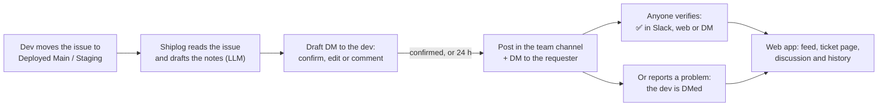
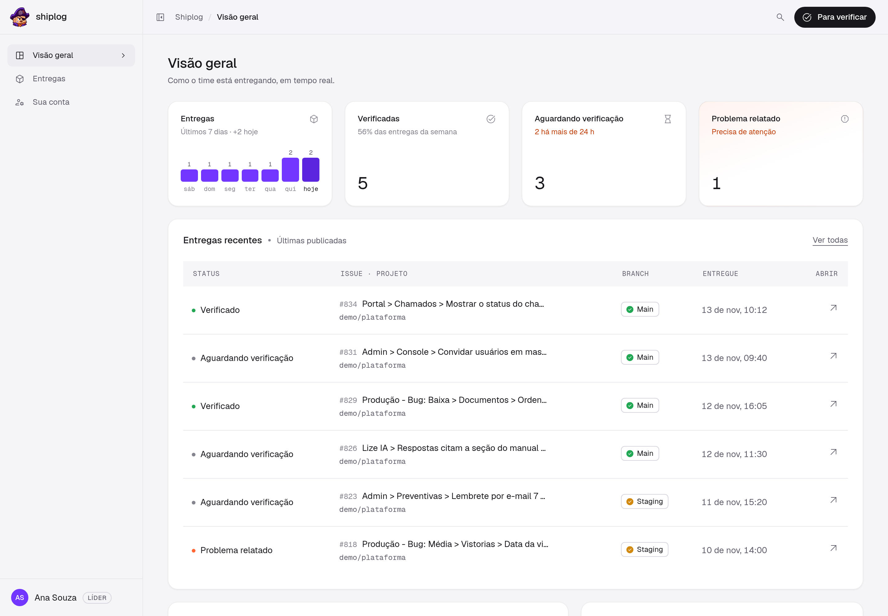
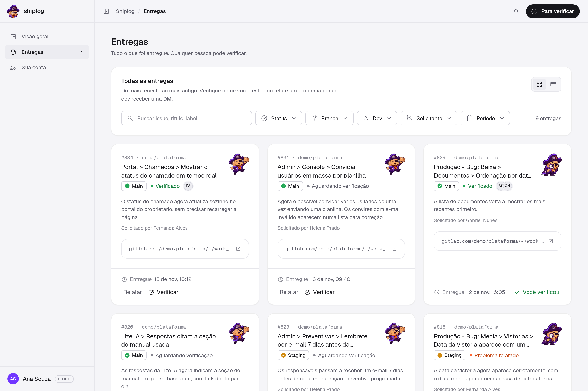
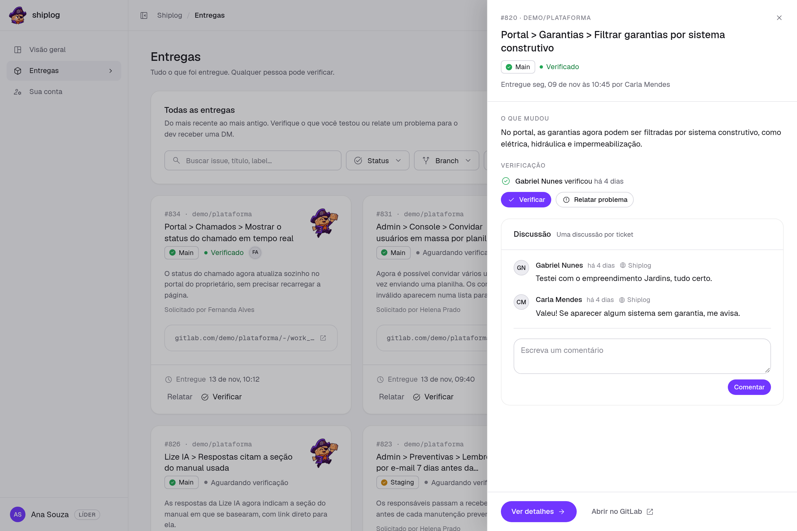
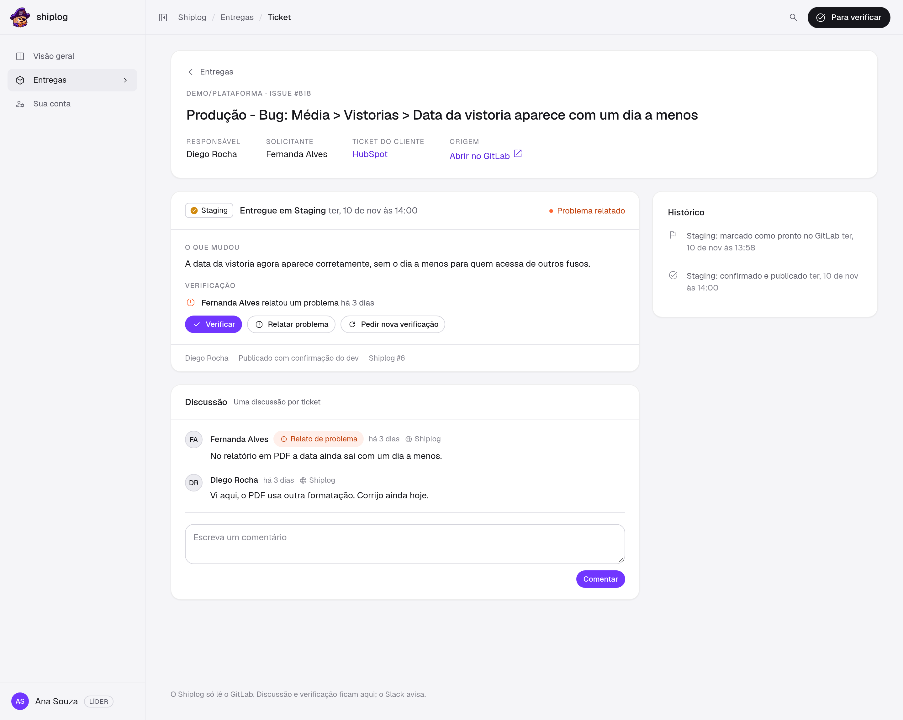

  

<h1 align="center">Shiplog</h1>

  <b>Every delivery announced, verified and on record, without anyone writing a Slack post.</b>

Shiplog turns "this issue is done" in GitLab into a delivery announcement the developer only has to confirm. The
team's Slack channel gets the post in its usual format, and the people who asked for the change are told it
shipped. A web app keeps the record of what shipped, where, and who checked it.

---

## The problem

Every deploy today ends with a developer writing a Slack message by hand: greeting, branch, issue link, HubSpot
link, title, a sentence on what changed, and a request to check it. That breaks down in predictable ways:

- **It gets skipped or delayed.** It's the last step after the real work, so it waits or never happens.
- **It's inconsistent.** Some posts say what changed, some repeat the title, links go missing.
- **Verification gets lost.** A ✅ in a busy channel is the only sign anyone tested it, and nobody can see later
  what was verified, by whom, or what still waits.
- **Problems go to the wrong place.** Reports end up in threads and DMs, and the developer hears late, or not at all.
- **There's no record.** "Did that fix go to production? Did anyone check it?" means scrolling the channel.

## How it works

1. **One step for the developer.** Moving the issue to *Deployed Main* / *Deployed Staging* (or adding the
   `Development: Done` label) is the trigger. The branch comes from the status, or from a `Branch:` label.
2. **A draft that writes itself.** Shiplog reads the issue and writes the "what changed" sentence, in the same
   style as the team's announcements. Personal data and secrets are removed before anything goes to the model.
3. **The developer stays in control.** The draft arrives as a private Slack DM: confirm, edit the notes, or
   comment. A reminder comes after 4 h, only during business hours, and it publishes itself after 24 h,
   flagged as unconfirmed.
4. **The channel post the team is already familiar with.** "Boa tarde, pessoal!", 🟦 MAIN / 🟨 STAGING, the issue and
   HubSpot links, the title, the notes quoted, "Verificar e dar um positivo aqui ✅". The person who asked for it
   gets a DM to verify.
5. **Verification that counts.** Anyone in the company can verify, by reacting ✅ on the post, clicking
   *Verificar* on the web, or from their DM. All three record the same verification. Reporting a problem DMs the
   developer with the comment.
6. **A permanent record.** The web app has the feed with filters, an overview of the week, a page per ticket with
   its discussion and history, and a "to verify" queue.

## Screenshots

| Overview | Deliveries |
|---|---|
|  |  |

| Side panel | Ticket page |
|---|---|
|  |  |

## What it does

**For developers**
- Shipping is the status change they already make; no message to write.
- An LLM-drafted description they confirm or edit from Slack.
- Nudges only when something needs them: which branch, MRs still open, a draft waiting.

**For the rest of the company**
- Sign in with the company Slack account; nothing else to set up.
- Verify what you tested with a ✅, or report a problem without hunting for the right person.
- See what shipped this week, what's verified, what's waiting, and what needs attention.

**For leads**
- One place to see deliveries by status, branch, developer, requester and date.
- A discussion per ticket, instead of scattered threads.
- Roles: members see what changed; developers and leads also see project paths and GitLab links.

## Principles

- **GitLab stays the source of truth.** Shiplog only reads it: no comments, no label changes, nothing written back.
- **No rankings.** No per-developer scores, leaderboards or performance metrics, now or later.
- **Code stays put.** Diffs are never stored. What goes to the model is the issue text, redacted, under a per-repo
  policy, and every call is logged.
- **Slack notifies; the web remembers.** Slack is where people act quickly; the web app is the record.

## Built with

Next.js 16 · Bun · PostgreSQL + Drizzle · pg-boss · Better Auth (Slack sign-in, GitLab connect) · Slack Web and
Events APIs · GitLab REST API (read-only) · OpenRouter (any OpenAI-compatible model) · Render.

## Documentation

| Document | For |
|---|---|
| [Roadmap](docs/ROADMAP.md) | What comes after v1 |
| [Technical overview](docs/TECHNICAL.md) | Architecture, flows, the LLM pipeline, security and data retention |
| [Development](docs/DEVELOPMENT.md) | Running it locally, scripts, tests, tunnels |
| [Scope and decisions](SCOPE.md) | The source of truth for behaviour, with every decision (D1–D55) |
| [Architecture notes](docs/ARCHITECTURE.md) | State machine and design details from the build |

The full guide, including Slack, GitLab and tunnels, is in [docs/DEVELOPMENT.md](docs/DEVELOPMENT.md).
