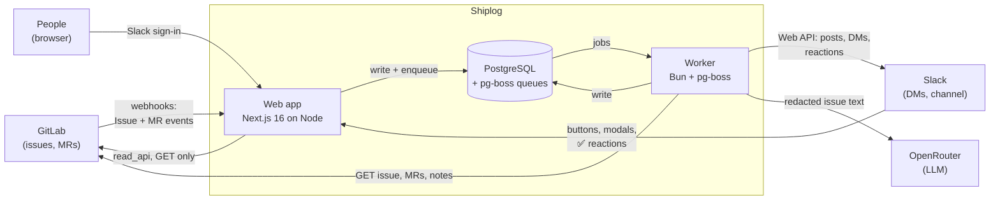
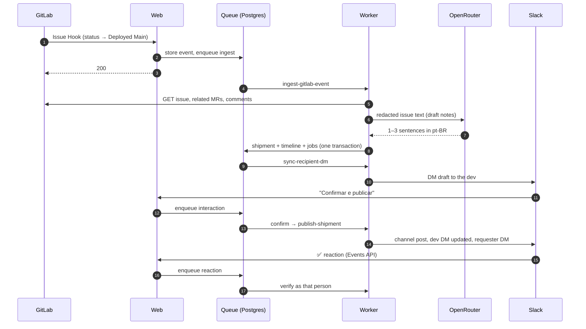
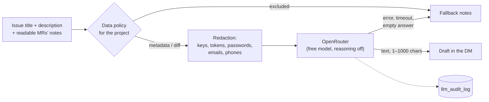

# Technical overview

How Shiplog is built, how data moves between GitLab, Slack, the LLM and the web app, and what it stores. This is
the current-state reference for v1. Behaviour and decisions live in [SCOPE.md](../SCOPE.md) (the `D` numbers below);
the state machine and design notes from the build are in [ARCHITECTURE.md](./ARCHITECTURE.md); running it locally is
in [DEVELOPMENT.md](./DEVELOPMENT.md).

**Contents:** [System](#system) · [Project layout](#project-layout) · [Data model](#data-model) ·
[GitLab](#gitlab) · [The delivery flow](#the-delivery-flow) · [Slack](#slack) · [LLM notes](#llm-notes-openrouter) ·
[Web app](#web-app) · [Security](#data-security-and-retention) · [Configuration](#configuration) ·
[Testing](#testing) · [Deployment](#deployment)

---

## System



Three processes share one Postgres database:

| Process | Runs | Does |
|---|---|---|
| **Web** (`shiplog-web`) | Next.js 16 (App Router) on Node | Pages, server actions, sign-in, and the three inbound endpoints. It checks signatures and permissions, writes the change, queues a job and answers. No slow work inline. |
| **Worker** (`shiplog-worker`) | Bun, `pg-boss` | Everything slow or outbound: reading GitLab, calling the LLM, posting and updating Slack messages, reminders and auto-publish timers. |
| **Database** | PostgreSQL | Application data and the job queues (pg-boss keeps its tables in the `pgboss` schema). |

Inbound endpoints:

| Endpoint | From | Does |
|---|---|---|
| `POST /api/webhooks/gitlab` | GitLab | Checks `X-Gitlab-Token`, stores the raw event (deduplicated on `X-Gitlab-Event-UUID`), queues `ingest-gitlab-event`, returns 200 |
| `POST /api/slack/interactions` | Slack | Checks the request signature, opens modals inline (Slack's `trigger_id` expires in 3 s), queues `handle-slack-interaction` |
| `POST /api/slack/events` | Slack | Checks the signature, answers Slack's URL check, queues ✅ reactions as `handle-slack-reaction` (D53) |
| `/api/auth/*` | Browser | Better Auth: Slack sign-in and GitLab connect |
| `GET /api/health` | Render | Health check |

**One rule keeps state consistent:** every change goes through a command in `src/lib/shipments/commands.ts`
(D39). The web, the Slack handlers and the worker all call the same commands. A command authorizes the actor, locks
the shipment row, applies the transition, writes a timeline entry and queues its follow-up jobs **in the same
transaction**, so a change and its Slack messages commit together or not at all. Jobs re-read the shipment and do
nothing if the state moved on, so retries and duplicates are harmless.

---

## Project layout

```
src/
  app/
    (app)/                    signed-in pages
      page.tsx                Visão geral (overview)
      feed/page.tsx           Entregas: filters, cards/list, side panel (?s=<shipment>)
      tickets/[id]/page.tsx   ticket page: deliveries, verification, discussion, history
      settings/page.tsx       Sua conta: connect GitLab, roles (leads)
      actions.ts              server actions: verify, unverify, report, comment…
    sign-in/                  Slack sign-in page
    api/
      webhooks/gitlab/        GitLab webhook receiver
      slack/interactions/     Slack buttons and modals
      slack/events/           Slack Events API (✅ reactions)
      auth/[...all]/          Better Auth
      health/                 health check
    dev/                      development-only: /dev/as (sign in as), /dev/slack-preview
  components/                 UI: shell, cards, filters (combobox), side panel, charts
  lib/
    shipments/                the domain
      commands.ts             THE ONLY PLACE STATE CHANGES
      state.ts                pure transition rules
      ingest.ts               GitLab event → ticket + shipment upsert → next steps
      effects.ts              next steps → queued jobs (in the command's transaction)
      queries.ts              role-aware read models for the pages
      recipient.ts, view.ts   who gets the DM; shipment → message view
    gitlab/                   webhook check, read-only API client, labels, triggers, templates
    slack/                    signature check, Web API client, Block Kit builders, interactions, events
    notes/draft.ts            LLM draft of the delivery notes
    policy/                   data policy (per repo) and redaction
    llm/provider.ts           OpenAI-compatible model (OpenRouter)
    auth/                     Better Auth config, identity rules, roles, viewer
    db/                       Drizzle schema and client
    dates.ts                  São Paulo time, business hours
    env.ts                    typed environment (zod)
  worker/
    index.ts                  queue registration
    jobs.ts                   queue names
    handlers/                 ingest, Slack messages, reactions, timers
config/
  data-policy.yaml            what may be sent to an LLM, per GitLab group/project
  weight-rubric.md, calibration.yaml   for the weight review (after v1)
drizzle/                      SQL migrations
scripts/                      set-role, link-gitlab, replay-event, fake-gitlab, eval-weights
tests/                        vitest: unit tests, plus flow tests against a real test database
```

Layers, from the outside in: route handlers, server actions, Slack handlers and job handlers are thin (parse
input, find the actor, call a command or query). Commands and queries hold the rules. Adapters (`gitlab/`, `slack/`,
`llm/`, `policy/`) talk to the outside world.

---

## Data model

| Table | Holds |
|---|---|
| `gitlab_events` | Every webhook delivery as received (raw JSON), with when it was processed and any error. The audit trail of what GitLab sent, and what `replay-event.ts` re-runs |
| `tickets` | A cached GitLab issue: project, number, title, URL, labels, weight, assignees, requester (raw name and matched Slack ID), HubSpot links, state and work item status. Not the description |
| `shipments` | One delivery of a ticket to one branch (unique per ticket + branch): status, notes draft and final, who receives the DM, Slack message references, timers, verification status and a timeline of everything that happened |
| `shipment_merge_requests` | MRs linked to a delivery, with counts only (lines, files, review rounds). Never diffs |
| `verifications` | One row per person per delivery: verified or problem reported |
| `comments` | The ticket's discussion, from the web or Slack |
| `llm_audit_log` | One row per model call: purpose, model, which issue/MRs were included and under which policy, redaction counts, payload hash and size, tokens, latency, error |
| `weight_reviews` | Reserved for the weight review (after v1) |
| `user`, `session`, `account`, `verification` | Better Auth: people, sessions, linked Slack/GitLab accounts, and sign-in state. `user.role` is `member`, `dev` or `lead` |

**Shipment statuses** (D40): `needs_branch` → `awaiting_hold_decision` → `held` → `pending_confirmation` →
`published`. Verification is separate from status: `unverified`, `verified` (someone verified, nobody reported a
problem) or `issue_reported`.

---

## GitLab

Shiplog is **read-only** toward GitLab: `src/lib/gitlab/client.ts` only issues `GET` requests, and a test fails if
that file ever names a write method.

**Inbound: webhooks.** A webhook on the project (Issue and Merge Request events) posts to
`/api/webhooks/gitlab` with a shared secret in `X-Gitlab-Token`. The route compares it in constant time, stores the
payload (a repeated `X-Gitlab-Event-UUID` is ignored) and answers 200 straight away, because GitLab disables hooks
that time out.

**What triggers a delivery** (D44): the `Development: Done` label being added, or the work item status moving to
one of `STATUS_TRIGGERS` (`Done`, `Deployed Main`, `Deployed Staging`). `Deployed <branch>` names the branch;
otherwise it comes from `Branch: <name>` labels. Adding a new branch later (Staging, then Main) creates a second
delivery for the same ticket.

**Outbound: the API** (token with `read_api`). For each triggered issue the worker reads:
- the issue (title, description, labels, weight, assignees);
- its related merge requests, plus MRs referenced in the issue's comments, internal ones included (`group/proj!N`,
  `!N`, or an MR URL; D48);
- for merged MRs, line and file counts, computed from the diff in memory and discarded.

**Who gets the DM** (D4, D45): the first person, in order assignees → MR authors → who moved the status, who has
connected their GitLab account. If nobody has, the delivery isn't created: Shiplog only works with people who
connected GitLab.

**Limit in v1:** the API token is a *project* token for `p1429/predialize`. It can't read MRs in other repos (most
live under `p1429/modules/…`), so MR counts are hidden in v1 (D51, D55). A group token lifts this; see the
[roadmap](./ROADMAP.md).

---

## The delivery flow



1. **Gates, in order** (D40): no branch → the DM asks "which branch?"; open MRs → "wait for the merge or publish
   anyway?" (held deliveries are re-checked on each MR event); otherwise the draft goes out.
2. **The draft DM** shows the issue, requester, the notes and buttons: *Confirmar e publicar*, *Editar notas*,
   *Comentar*. If the issue's `Solicitante` doesn't match exactly one Slack user, the DM asks who it is.
3. **Timers** (D54): a reminder in the DM thread 4 h after the draft, moved to the next São Paulo business time
   (Monday–Friday, 9:00–18:00) when it would land outside it; auto-publish after 24 h, flagged as unconfirmed notes.
   Timers belong to one draft cycle, so a newer draft cancels them.
4. **Publishing** posts the channel announcement in the team's format (D49), turns the dev's DM into "publicada",
   and DMs the requester with *Verificar* / *Relatar problema*. Editing the notes after publishing edits the channel
   post in place.
5. **Verification** comes from the web, the requester's DM or a ✅ on the channel post, and lands on the same
   command. A reported problem adds a comment and DMs the developer. The developer or a lead can ask the reporters
   to check again (at most once an hour).

---

## Slack

One Slack app does three jobs:

| Job | How | Scopes / settings |
|---|---|---|
| **Sign-in** | Sign in with Slack (OpenID Connect), limited to the company workspace (`SLACK_TEAM_ID`) | OpenID scopes |
| **Bot** | Posts the channel announcement, sends and updates DMs, adds/removes its own ✅ | `chat:write`, `im:write`, `users:read`, `reactions:read`, `reactions:write` |
| **Callbacks** | Interactivity URL → `/api/slack/interactions`; Event Subscriptions → `/api/slack/events` (`reaction_added`, `reaction_removed`) | Signing secret |

**Requests from Slack are verified** with HMAC-SHA256 over the raw body and the signing secret, compared in
constant time, and rejected when older than 5 minutes.

**Messages are updated, not re-sent.** Each delivery has one DM to the developer (updated in place as it moves
through branch → MRs → draft → published), one channel post and one requester DM. The Block Kit builders in
`src/lib/slack/blocks.ts` are pure functions, snapshot-tested and previewable at `/dev/slack-preview`.

**✅ sync** (D53): a ✅ on the channel post verifies as that Slack user (creating their Shiplog account on first
contact); removing it takes the verification back, never a reported problem. When a delivery is verified in
Shiplog and nobody has reacted, the bot adds its own ✅, and removes it once people react or the delivery stops
being verified. Slack only lets an app remove its own reactions, so undoing a verification on the web leaves that
person's ✅ in place.

**Requester matching:** the issue's `Solicitante` (a table column or a line in the description) is compared,
without case or accents, with Slack names; one match resolves it, otherwise the developer picks.

**Development guard:** with `SLACK_DM_ALLOWLIST` set, DMs to anyone not on it go to the first ID instead, marked
with who they were for. Unset in production.

---

## LLM notes (OpenRouter)

The "what changed" sentence is drafted by a model (D50), with the rules of the team's
`pdz-generate-slack-communication` skill: Brazilian Portuguese, 1–3 short sentences, what changed for the people
using the platform, nothing that isn't in the source text, no title path, links, names or redacted bits.



- **When:** at ingest, before the shipment is written, only when a delivery is created or re-created.
- **Input:** the issue title and description (HTML comments stripped, capped at 6,000 characters), and each
  readable MR's `## Notas de entrega` or title. When the developer wrote notes, the model only fixes language and
  readability.
- **Data policy** (`config/data-policy.yaml`): each GitLab group or project resolves to `diff`, `metadata` or
  `excluded`, most specific first, with `metadata` as the default. An excluded issue is never sent; excluded MRs are
  left out.
- **Redaction** before every call: private keys, connection strings with credentials, tokens (GitLab, Slack,
  OpenAI/OpenRouter-style, GitHub, AWS, JWTs), `password=`/`token=`-style secrets, emails and phone numbers. The
  count per rule goes to the audit log.
- **Call:** the AI SDK with an OpenAI-compatible provider (`LLM_BASE_URL`, `LLM_API_KEY`, `LLM_MODEL`). Plain-text
  output, because most free models don't support structured outputs; up to 1,000 tokens; reasoning turned off for
  OpenRouter, since reasoning models otherwise spend the whole budget thinking and return nothing; one retry; 30 s
  timeout.
- **Fallback:** if the LLM is off, the project is excluded, or the call fails, times out or returns an empty or
  oversized answer, the notes fall back to the MR notes, else the MR title, else the issue title. A delivery is
  never blocked by the model.
- **Audit:** every call writes a row to `llm_audit_log` with the provider, model, the issue and MRs included and the
  policy applied to each, redaction counts, a SHA-256 of the exact payload and its size, tokens, latency and any
  error. The payload itself isn't stored, so "what left the company for #5108?" has an exact answer without keeping
  a copy.
- **Model choice** (D52): v1 uses an OpenRouter free model (50 requests a day is the free limit; Shiplog sends
  around 15 at most). A paid model with zero data retention, or a direct provider key, is a configuration change.

---

## Web app

- **Next.js 16 App Router with Cache Components.** Pages are server-rendered; anything that reads the URL or the
  signed-in person renders inside a Suspense boundary. Client components are limited to interactive pieces: the
  sidebar, filters (a custom accessible combobox, no UI library), the side panel and forms.
- **Pages:** *Visão geral* (week tiles, recent deliveries, what needs attention, the week's verification, team
  activity), *Entregas* (search and filters, cards or list, side panel at `?s=<shipment>`), the ticket page,
  and *Sua conta*.
- **Roles are enforced on the server**, in commands and queries, not by hiding buttons:
  - `member`: everyone who signs in with Slack. Sees deliveries, verifies, reports, comments.
  - `dev`: connected GitLab (only possible for members of the GitLab group). Also sees project paths and GitLab
    links, and answers their own deliveries' DMs.
  - `lead`: set by another lead (the last lead can't step down). Can act on any delivery and change roles.
- **No per-developer aggregates** anywhere (D38): charts and counts are team totals.
- Interface and Slack messages are pt-BR (D37); every date and day bucket uses `America/Sao_Paulo` (D42).

---

## Data security and retention

**Access**
- Sign-in is only through Slack, only for the company workspace. GitLab is linked afterwards, from a Slack
  session, and only by members of the GitLab group.
- Development shortcuts (`/dev/as`, `/dev/slack-preview`) return 404 in production; `/dev/as` also refuses
  anything that isn't a direct request from the same machine (tunnel traffic included).
- Inbound requests are authenticated: GitLab by its secret token, Slack by its request signature. Both are
  compared in constant time.
- The GitLab token is `read_api` only and the client is GET-only.

**What Shiplog stores**

| Data | Where | Kept |
|---|---|---|
| Raw GitLab webhook payloads (issue fields including the **description**, labels, people) | `gitlab_events` | Indefinitely today. A retention window is on the [roadmap](./ROADMAP.md#later) |
| Issue metadata (title, labels, weight, assignees, requester name, HubSpot links) | `tickets` | While the app runs; the description itself isn't copied here |
| Delivery notes, timeline, verifications, comments | `shipments`, `verifications`, `comments` | Indefinitely: this is the record |
| MR metadata and counts | `shipment_merge_requests` | Indefinitely; **diffs are never stored** (counted in memory and discarded) |
| People (name, email, avatar URL, role) and sessions | Better Auth tables | While the account exists |
| OAuth tokens from Slack sign-in and GitLab connect | `account` | Stored by Better Auth in the database, not encrypted at the column level today |
| What was sent to the LLM | `llm_audit_log` | Only a hash, the size, sources and redaction counts. Never the text |

**What leaves the company**
- **To Slack:** messages to the channel and DMs (titles, notes, links, names).
- **To OpenRouter and the model's provider:** the redacted issue title and description and MR notes, once per
  delivery. On a free model, the provider may log prompts; that was accepted for the v1 trial (D52). Excluded
  projects never leave.
- **Never:** source code or diffs, GitLab tokens, Slack tokens.

**Secrets** live in environment variables (Render's secret env group in production). Nothing secret is committed;
`.env` is ignored.

---

## Configuration

All settings are environment variables, validated with zod on first use (`src/lib/env.ts`); `.env.example`
documents each one.

| Group | Variables |
|---|---|
| App | `APP_URL`, `DATABASE_URL`, `BETTER_AUTH_SECRET` |
| Slack | `SLACK_CLIENT_ID`, `SLACK_CLIENT_SECRET`, `SLACK_TEAM_ID`, `SLACK_BOT_TOKEN`, `SLACK_SIGNING_SECRET`, `SLACK_FEED_CHANNEL_ID`, `SLACK_DM_ALLOWLIST` (development) |
| GitLab | `GITLAB_BASE_URL`, `GITLAB_GROUP_PATH`, `GITLAB_API_TOKEN`, `GITLAB_WEBHOOK_SECRET`, `GITLAB_OAUTH_CLIENT_ID`, `GITLAB_OAUTH_CLIENT_SECRET`, `GITLAB_MEMBERSHIP_PROJECT` (needed with a project token) |
| Labels and triggers | `LABEL_DONE`, `LABEL_BRANCH_PREFIX`, `LABEL_WEIGHT_PREFIX`, `STATUS_TRIGGERS`, `STATUS_DEPLOYED_PREFIX`, `BRANCH_CHOICES` |
| Timing | `REMINDER_AFTER_HOURS` (4), `AUTO_PUBLISH_AFTER_HOURS` (24) |
| LLM | `LLM_ENABLED`, `LLM_PROVIDER_NAME`, `LLM_BASE_URL`, `LLM_API_KEY`, `LLM_MODEL` |

---

## Background jobs

| Job | Does |
|---|---|
| `ingest-gitlab-event` | Runs the ingest pipeline for one stored webhook |
| `sync-recipient-dm` | Posts or updates the developer's DM for the current status |
| `send-reminder`, `auto-publish` | The draft's timers |
| `publish-shipment` | Channel post (or its update), the developer's DM, the requester's DM |
| `sync-requester-dm` | Keeps the requester's DM in line with their verification |
| `notify-issue-reported`, `notify-comment` | DMs the developer about a problem or a comment |
| `request-reverification` | DMs reporters to check again |
| `handle-slack-interaction`, `handle-slack-reaction` | Buttons, modal submissions and ✅ reactions |
| `sync-feed-reaction` | The bot's own ✅ on the channel post |

Queues retry five times with exponential backoff, so a Slack or GitLab hiccup doesn't lose work.

---

## Testing

`bun run test` (vitest) runs about 190 tests:
- **Pure:** label and trigger parsing, templates (requester, delivery notes, HubSpot links), MR references in
  comments, redaction and data policy, business hours, Block Kit builders (snapshots), Slack signature checks.
- **Against a real Postgres** (`TEST_DATABASE_URL`): ingest end to end with the GitLab API mocked, the Slack flow
  (DM → confirm → publish → verify → report → re-verify, ✅ reactions) with Slack and the queue mocked, queries per
  role, and the LLM drafter with a mock model (redaction, audit row, fallback).
- Tests never call a real model or Slack.

`bun run typecheck` and `bun run lint` complete the checks.

---

## Deployment

v1 runs on free plans (D56): one Render web service built from the `Dockerfile`, whose start script
(`scripts/start.sh`) runs the migrations and then the worker and the web app side by side; a Supabase Postgres;
OpenRouter's free model; and a 10-minute keep-alive ping, because a free Render service sleeps when idle and Slack
expects answers within 3 seconds. `render.yaml` is the blueprint, `docs/slack-manifest.yaml` creates the production
Slack app, and [DEPLOY.md](./DEPLOY.md) is the step-by-step guide.

Moving to paid plans later is a configuration change: `bun run start` and `bun run worker` also run as separate
services, and `DATABASE_URL` can point at any Postgres.

CI (GitHub Actions, `.github/workflows/ci.yml`) runs lint, typecheck, the tests against a Postgres service, and the
production build on every pull request and push to `main`.
